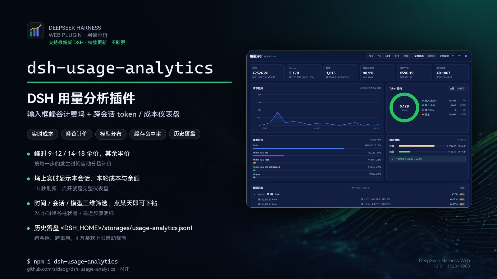
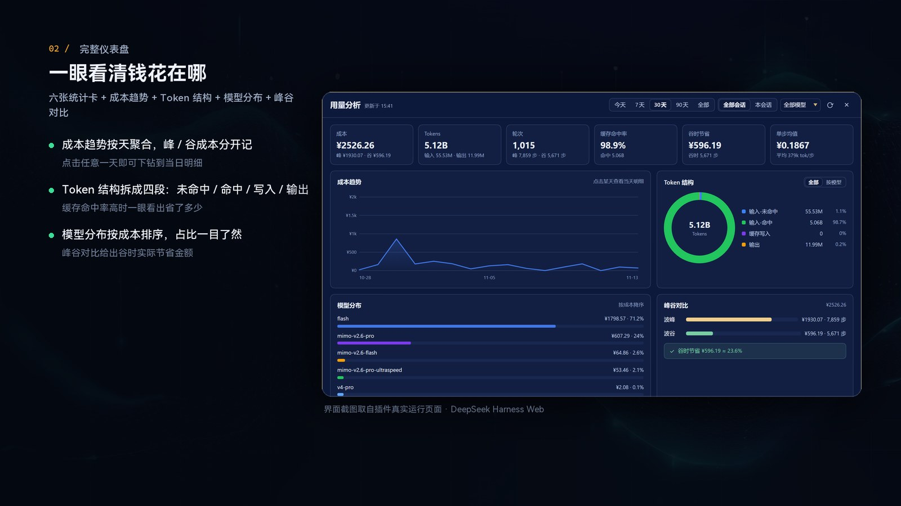
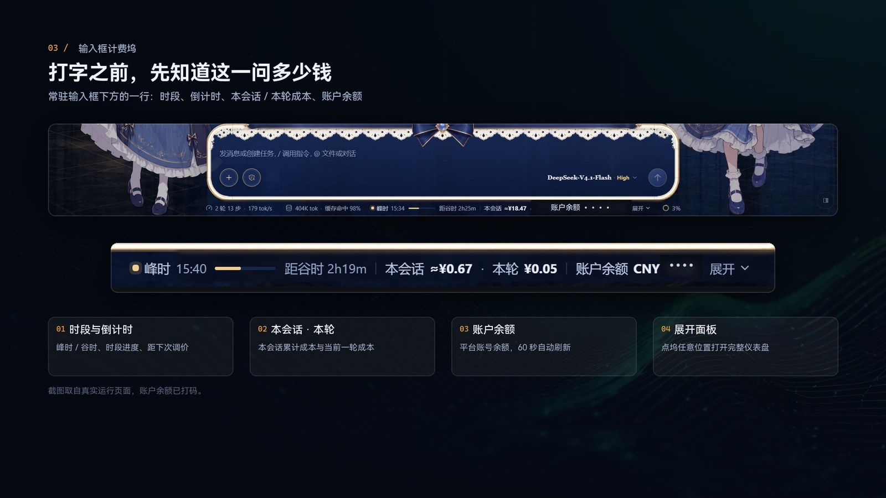
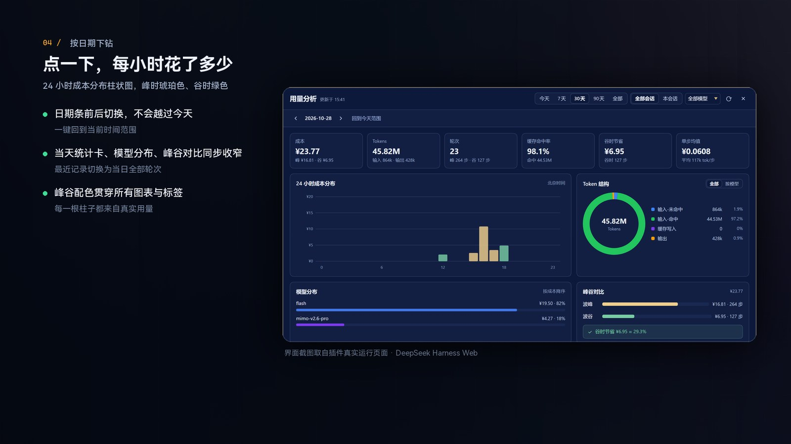
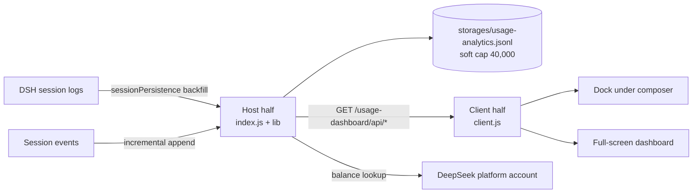

# dsh-usage-analytics

[](LICENSE)
[](https://www.npmjs.com/package/dsh-usage-analytics)
[](#compatibility--maintenance)
[](#compatibility--maintenance)
[](#compatibility--maintenance)
[](#requirements)
[](https://github.com/zixiaog/dsh-usage-analytics/actions/workflows/check.yml)

A DeepSeek Harness (DSH) plugin that puts a **peak/off-peak billing dock** under the composer and a **full usage dashboard** on top of every session's token and cost history.

The dock tells you, at a glance, what the current conversation has cost, what this turn is costing, and how far away the next price window is. The dashboard answers the bigger question — "where did this week's money go?" — with cost trends, token structure, model mix, a peak/valley split, and turn-by-turn records across all sessions, not just the one that is open.

> Built for DSH `0.2.x` with the Web UI. No build step and no runtime dependencies: the host half is plain Node ESM, the client half is a single dynamic module served by DSH.

> **Supports the latest DSH · continuously updated.** Verified against the current `latest` (**DSH `0.2.2-rc.1`**) and the `next` line (`0.2.2-rc.2`). This plugin is actively maintained: when a DSH release changes a service, event, slot or storage contract it relies on, a matching plugin release follows — see [Compatibility & maintenance](#compatibility--maintenance) and [CHANGELOG.md](CHANGELOG.md).

中文文档：[README.zh-CN.md](README.zh-CN.md)

---

## Features

- **Peak/off-peak billing dock under the composer** — current price period (peak or valley), progress through that period, countdown to the next switch, accumulated cost for the session, cost of the current turn, and your account balance.
- **Cross-session history on disk** — every step is appended to `<DSH_HOME>/storages/usage-analytics.jsonl`, so history survives restarts, closed sessions and profile reloads instead of disappearing with the chat window.
- **Dashboard filters** — time range (today / 7 / 30 / 90 days / all), session scope (all sessions / this session), and model; every card and chart follows the current filter.
- **Charts** — cost trend line, 24-hour peak/valley bars for a single day, token-structure donut (cache-miss input, cache-hit input, cache write, output), model distribution bars, and a peak/valley comparison.
- **Date drill-down** — click a day in the trend chart to narrow everything to that day, step through neighbouring dates with `‹` / `›`, and jump back to the current range with one click.
- **Recent records** — the latest turns grouped by turn, collapsible down to individual steps with input / cache-read / output / cost for each step.
- **Account balance** — read from the DeepSeek platform account you are signed in with; when that is unavailable the dock and dashboard show `—` instead of an error.

---

## Preview



| The dashboard | The dock | A single day |
| --- | --- | --- |
|  |  |  |
| Filters, six stat cards, trend, token mix, model distribution, peak/valley split | One compact row under the composer: period, countdown, session and turn cost, balance | Click a day for 24-hour peak/valley bars |

More screenshots: [`docs/screenshots/`](docs/screenshots) — this-session scope, cross-session history, token structure and install.

---

## Compatibility & maintenance

| | |
| --- | --- |
| **DSH support** | `0.2.x` — verified against `0.2.2-rc.1` (current `latest`) and `0.2.2-rc.2` (current `next`) |
| **Update policy** | **Continuous — the plugin tracks DSH, not the other way round.** Every upstream release that changes a contract it uses gets a matching plugin release |
| **Contracts relied on** | `sessionPersistence` (session logs), the `session/event` firehose, `webServer` routes, `deepseekAccount.getBalance`, the slot API (`conversation.composer.dock`, `shell.overlay`) and DSH theme tokens |
| **How drift is caught** | The unit suite covers pricing, folding, storage, backfill and the HTTP API; CI runs it on Node 20. A breaking upstream change shows up as a failed check or a slot error before it reaches a release |
| **When it breaks anyway** | Open an issue with your DSH version and the console error; a patch release follows. Version history is in [CHANGELOG.md](CHANGELOG.md) |

Supported **DSH versions are raised, never lowered**: a release notes the exact DSH version it was verified against, so you always know what "latest" means for a given plugin version.

---

## Requirements

| Item | Requirement |
| --- | --- |
| DSH | `0.2.x` with the Web UI (web profile) |
| Node.js | `>= 20` (`package.json` → `engines`); the host half runs on the Node bundled with DSH |
| Runtime dependencies | none — only Node built-ins and DSH services |
| Browser | any recent browser; the UI is themed entirely from DSH CSS tokens |
| OS | Windows, macOS or Linux (this is a Web UI plugin; it has no platform-specific code) |

---

## Installation

### 1. From npm (recommended)

```bash
dsh plugin --profile <profile> add dsh-usage-analytics
```

`<profile>` is the DSH profile whose Web UI you use — for example `desktop`. To pin a version:

```bash
dsh plugin --profile <profile> add dsh-usage-analytics@0.1.0
```

Restart DSH after the command finishes. The plugin is mounted on the next start and the dock appears under the composer input.

### 2. From a GitHub Release tarball

Every release publishes a packed tarball (`dsh-usage-analytics-<version>.tgz`) under **Releases**. Install it as a local package — no registry access needed:

```bash
dsh plugin --profile <profile> add ./dsh-usage-analytics-0.1.0.tgz
```

Then restart DSH. This is the way to go if the machine cannot reach npm, or if you want to install a build that was never published.

### 3. Manual install

1. Extract the release tarball so the package directory ends up at (npm tarballs contain a top-level `package/` directory that needs renaming):

   ```text
   <profile>/node_modules/dsh-usage-analytics/
   ```

2. Add one insert row to the profile's `cordis.patch.yml`:

   ```yaml
   - insert:
       - id: usage-analytics
         name: 'dsh-usage-analytics'
   ```

3. Restart DSH.

The `name` must match the directory you extracted under `node_modules`. If you keep the package somewhere else, point the row at that directory with a path relative to the patch file instead, for example `name: './vendor/dsh-usage-analytics'`.

To uninstall, use the plugin manager — or, for a manual install, remove the row and the directory. The plugin writes no profile settings. Your usage history stays in `<DSH_HOME>/storages/usage-analytics.jsonl` — delete that file together with its `usage-analytics.meta.json` companion to start from a clean slate (keeping the meta file alone would leave the backfill watermarks behind).

---

## Usage

### The dock

The dock is one compact row under the message composer:

- a coloured dot (amber for peak, green for valley), the current period, a thin progress bar for how much of the period has elapsed, and a countdown to the next switch;
- the accumulated cost of the current session and the cost of the current turn;
- the account balance (`—` when it cannot be fetched);
- an expand chevron on the right.

Click anywhere on the row to open the dashboard. Live figures refresh every 15 seconds and the balance every 60 seconds; values that have not arrived yet are shown as `—`, so the row never jumps around while loading.

### The dashboard

Open it from the dock. It closes with `×`, `Esc`, or a click on the backdrop.

- **Filter bar** — `Today / 7 days / 30 days / 90 days / All`, `All sessions / This session`, a model dropdown, a refresh button and the close button. Changing any filter reloads every card and chart.
- **Six stat cards** — cost (with peak / valley split), tokens (with input / output split), turns, cache hit rate, valley savings, and average cost per step.
- **Cost trend** — one point per day in the current range. Hover for the day's cost; click a day to drill into it.
- **Token structure** — donut with cache-miss input, cache-hit input, cache write and output; switch between all models and a single model.
- **Model distribution** — horizontal bars ranked by cost, with share of the total.
- **Peak / valley comparison** — how much was spent at full price and how much at half price, plus the amount saved by running in valley hours.
- **Recent records** — the latest turns, each expandable into its steps. On "This session" the records belong to the open conversation; on "All sessions" each turn carries a small session label.
- **Date bar** — while drilled into a day, `‹ 2026-11-12 ›` switches dates (never past today) and **Back to today's range** leaves the day view.

When the selected range has no usage yet, the charts show a short "no usage recorded yet — say something first" placeholder instead of empty axes.

---

## Data and pricing

### Where the data lives

Usage history is stored in one append-only JSONL file:

```text
<DSH_HOME>/storages/usage-analytics.jsonl
```

- one compact JSON object per step: session and sequence ids, turn/step, timestamp, provider and model, the four token counters, the estimated cost and the peak flag;
- **one file spans all sessions and all restarts** — it is not tied to a conversation, so closing or deleting a chat does not erase what it cost;
- a small `usage-analytics.meta.json` sits next to it and remembers each session's backfill watermark and display label;
- the file has a **soft cap of 40,000 records** by default (configurable with `historyLimit`); past the cap the oldest records are trimmed automatically, which keeps the dashboard responsive and the file small;
- history is backfilled from the session logs that already exist, new steps are captured live as they finish, and the history is re-scanned periodically to pick up anything the live path missed.

Because of the cap, `All` reaches back as far as the stored records go — usually far more than 90 days for a normal workload, but not literally forever.

### How the bill is estimated

DeepSeek prices tokens differently in **peak** and **valley** hours. This plugin follows the Beijing-time (UTC+8) schedule:

| Period | When | Price |
| --- | --- | --- |
| Peak | Monday–Friday, `09:00–12:00` and `14:00–18:00` | full price |
| Valley | every other time, plus all day Saturday and Sunday | 50% by default (`valleyFactor`) |

Every step is classified by its own timestamp and priced as:

```text
cost = input × price.input
     + cacheRead × price.cacheRead
     + cacheWrite × price.cacheWrite
     + output × price.output
     (then × valleyFactor during valley hours — 0.5 by default)
```

Prices are CNY per 1 million tokens. A built-in table covers the DeepSeek model families — `deepseek-v4-pro`, `deepseek-reasoner`, `deepseek-chat`, `deepseek-flash` and a `default` fallback — and **you can override any model through the plugin config** (`prices`, see below), which is the right thing to do if your plan, contract or currency differs. Valley steps are billed at 50% of the peak price unless `valleyFactor` says otherwise.

> **These amounts are estimates.** They are computed locally from the token counts DSH records and the price table in effect at the time. Price changes, unrecorded cache writes, provider-side rounding or a long-running request that crosses a price boundary can all make the estimate differ from what you are actually charged. The official DeepSeek bill is always the source of truth.

---

## Configuration

Configuration is optional — the defaults work out of the box. To change something, add a `config` block to the plugin row in the profile's `cordis.patch.yml`:

```yaml
- insert:
    - id: usage-analytics
      name: 'dsh-usage-analytics'
      config:
        prices:
          deepseek-chat:
            input: 2.0        # CNY / 1M cache-miss input tokens
            cacheRead: 0.5    # CNY / 1M cache-hit input tokens
            cacheWrite: 2.0   # CNY / 1M cache-write input tokens
            output: 8.0       # CNY / 1M output tokens
        peakHours:            # Beijing time (UTC+8)
          - '09:00-12:00'
          - '14:00-18:00'
        storagePath: '/path/to/usage-analytics.jsonl'   # omit for <DSH_HOME>/storages/...
        debug: false
```

The prices above are the built-in defaults for `deepseek-chat`, shown as an illustration — set them to whatever you are actually charged.

| Key | Type | Default | Meaning |
| --- | --- | --- | --- |
| `prices` | object | built-in table | Per-model token prices in CNY per 1M tokens, with `input`, `cacheRead`, `cacheWrite` and `output`. An entry replaces that model's built-in row as a whole — include all four fields, since omitted ones become `0`. |
| `peakHours` | string array | `09:00-12:00`, `14:00-18:00` on weekdays | Windows billed at full price in Beijing time; everything outside them is valley time. A `peakWindows` array of `[startMinute, endMinute]` pairs is accepted as an alternative and wins when both are valid. |
| `storagePath` | string | `<DSH_HOME>/storages/usage-analytics.jsonl` | History file. An absolute path is used as-is; a relative one is resolved under `DSH_HOME` (so `storages/usage-analytics.jsonl` stays inside the DSH data directory). A directory path, or the `storageDir` key, is also accepted. |
| `debug` | boolean | `false` | Writes verbose host-side logging (backfill progress, pricing decisions, balance failures). Leave it off unless you are diagnosing something. |
| `historyLimit` | number | `40000` | Soft cap on stored step records (minimum `1000`). Past the cap, the oldest records are trimmed. |
| `peakDays` | number array | `[1, 2, 3, 4, 5]` | Weekdays that can be peak, using `Date#getUTCDay` numbering (`0` = Sunday … `6` = Saturday). With the default, weekends are valley all day. |
| `valleyFactor` | number | `0.5` | Multiplier applied to the price in valley hours, clamped to `0`–`1`. |

A `config` block is replaced as a whole, not merged: if you override one key, restate the others you care about or leave them at their defaults. After editing the file, restart DSH (or disable/enable the plugin) for the change to take effect.

If you installed through `dsh plugin add`, the row already exists — edit its `config` in place instead of adding a second row.

---

## How it works



The host half backfills existing history on start, captures new steps as they finish, prices them with the peak/valley schedule, and serves the result over a small same-origin HTTP API. The client half registers two slots: the compact dock under `conversation.composer.dock` and the dashboard inside `shell.overlay`. The only files the plugin writes are the history file and its small meta companion (plus normal DSH logs while `debug` is on), and chat content is never uploaded.

The full design — collection, retention, pricing, API and client structure — is in [docs/DESIGN.md](docs/DESIGN.md).

---

## Development

There is no build step. The host half is ESM and is loaded directly; the client half is a `window.__ModuleLoader__` dynamic module, loaded as-is by the browser.

```bash
npm test        # node scripts/test.mjs — the node:test suites in one process
npm run check   # node scripts/check.mjs
```

`npm test` imports the `node:test` suites and runs them in a single process (which also works where spawning test workers is not available); `npm run check` runs the static checks (syntax, JSON validity, manifest consistency). Both must pass before a PR is merged — the CI workflow does exactly the same on Node 20.

To try a local change: install the directory into a test profile, edit `client.js` and reload the page, or edit the host files and restart DSH (or disable/enable the plugin row) so the new host code is mounted.

Development notes, code layout and the manual test checklist are in [CONTRIBUTING.md](CONTRIBUTING.md).

---

## Known limitations

- **The first scan reads session logs.** Backfill decodes existing session history under a time budget, so after installing (or after deleting the history files) a large profile converges over a few sync rounds; later starts only catch up on new steps.
- **Balance needs a signed-in DeepSeek account.** When DSH has no platform session, or the balance endpoint cannot be reached, the UI shows `—` and does not raise an error.
- **Costs are estimates.** See [How the bill is estimated](#how-the-bill-is-estimated); the official bill always wins.
- **History is capped.** The default 40,000-record soft cap (`historyLimit`) trims the oldest steps, so the `All` range is bounded by what is still stored.
- **Only usage DSH records is counted.** Tokens spent outside this DSH profile, or by other tools sharing the same account, do not appear here.
- **DSH internals can move.** The plugin targets DSH `0.2.x` service and storage contracts; a DSH upgrade that changes them may require a matching plugin update.

---

## License

[MIT](LICENSE) © 2026 dsh-usage-analytics contributors
