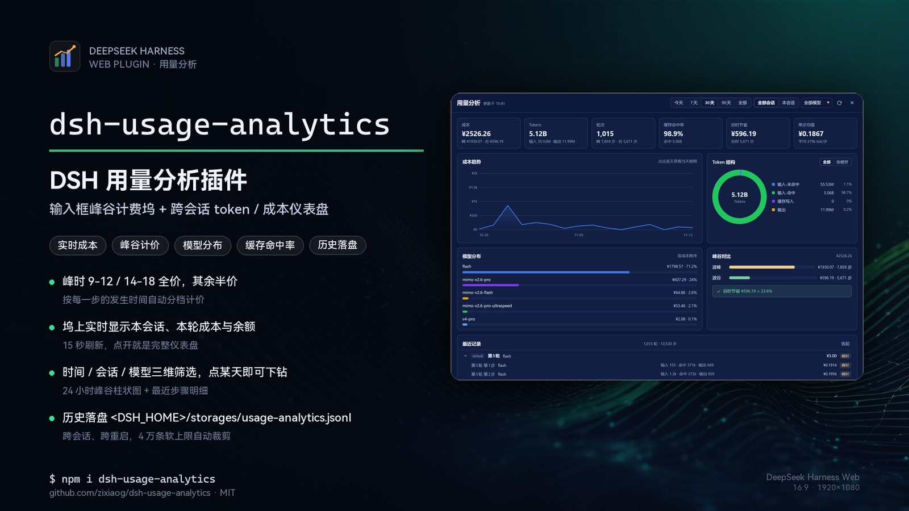
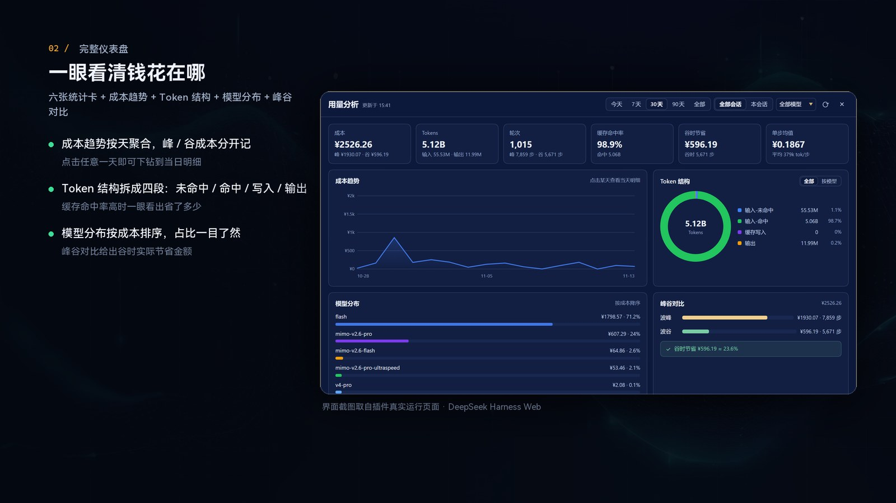
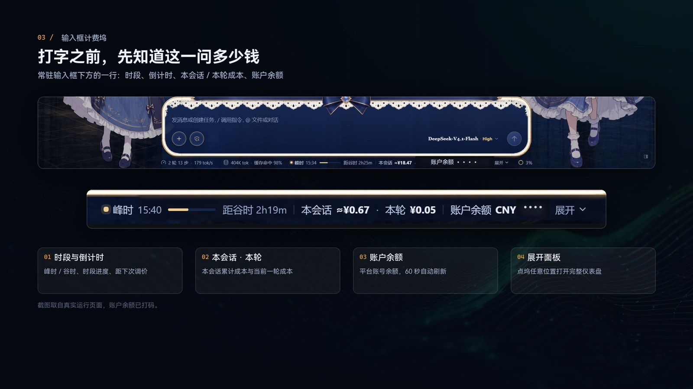
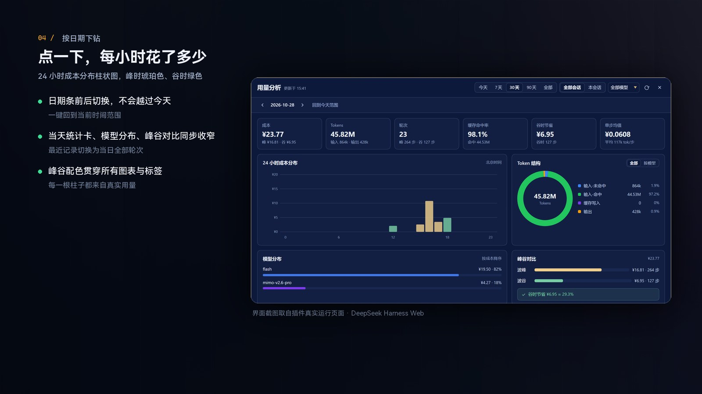
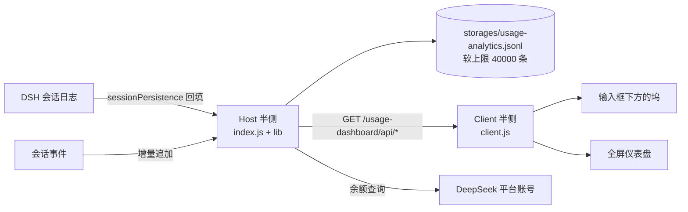

# dsh-usage-analytics

[](LICENSE)
[](https://www.npmjs.com/package/dsh-usage-analytics)
[](https://github.com/deepseek-ai)
[](#环境要求)
[](https://github.com/zixiaog/dsh-usage-analytics/actions/workflows/check.yml)

DeepSeek Harness（DSH）用量插件：在输入框下方挂一条**峰谷分时计费坞**，再配一个建立在全部会话 Token 与成本历史之上的**完整用量分析面板**。

坞告诉你这个会话已经花了多少、这一轮正在花多少、距离下一个计价时段还有多久；面板则回答更大的问题——“这周的钱花哪儿了”：成本趋势、Token 结构、模型分布、峰谷对比，以及跨会话、可逐轮逐步骤展开的最近记录。

> 面向 DSH `0.2.x` 的 Web UI。无构建步骤、无运行时依赖：Host 半侧是普通 Node ESM，Client 半侧是 DSH 直接下发的单个动态模块。

English: [README.md](README.md)

---

## 功能

- **输入框下方的峰谷计费坞**——当前计价时段（峰时/谷时）、当前时段进度、距下次切换的倒计时、本会话累计成本、本轮成本、账户余额。
- **跨会话历史落盘**——每个步骤都追加写入 `<DSH_HOME>/storages/usage-analytics.jsonl`；关掉聊天窗口、重启 DSH、重新加载 profile 之后历史仍在。
- **仪表盘筛选**——时间范围（今天 / 7 天 / 30 天 / 90 天 / 全部）、会话范围（全部会话 / 本会话）、模型；统计卡与图表全部跟随当前筛选。
- **图表**——成本趋势折线、单日的 24 小时峰谷柱状图、Token 结构环形图（输入未命中、输入命中、缓存写入、输出）、模型分布条形图、峰谷对比。
- **按日期下钻**——点击趋势图上的某一天，所有内容收窄到这一天；用 `‹` / `›` 前后翻日期；一键回到当前范围。
- **最近记录**——最近若干轮按轮次分组，可展开到单个步骤，显示每一步的输入 / 缓存命中 / 输出 / 成本。
- **账户余额**——读取你已登录的 DeepSeek 平台账号；拿不到时坞和面板显示 `—`，不弹错误。

---

## 预览



| 完整仪表盘 | 输入框计费坞 | 按日期下钻 |
| --- | --- | --- |
|  |  |  |
| 筛选、六张统计卡、成本趋势、Token 结构、模型分布与峰谷对比 | 输入框下方的一行：时段、倒计时、本会话/本轮成本、余额 | 点某一天查看 24 小时峰谷柱状图 |

更多截图见 [`docs/screenshots/`](docs/screenshots)：本会话视图、跨会话历史、Token 结构、安装说明。

---

## 环境要求

| 项目 | 要求 |
| --- | --- |
| DSH | `0.2.x`，带 Web UI（web profile） |
| Node.js | `>= 20`（见 `package.json` 的 `engines`）；Host 半侧实际运行在 DSH 自带的 Node 上 |
| 运行时依赖 | 无。只使用 Node 内置模块与 DSH 服务 |
| 浏览器 | 任意现代浏览器；界面颜色全部来自 DSH 主题 token |
| 操作系统 | Windows / macOS / Linux 均可（纯 Web UI 插件，无平台相关代码） |

---

## 安装

### 方式一：从 npm 安装（推荐）

```bash
dsh plugin --profile <profile> add dsh-usage-analytics
```

`<profile>` 是你实际在用的 DSH profile 名，例如 `desktop`。需要锁定版本时：

```bash
dsh plugin --profile <profile> add dsh-usage-analytics@0.1.0
```

命令执行完后重启 DSH。下次启动时插件即被挂载，计费坞出现在输入框下方。

### 方式二：从 GitHub Release 的 tarball 安装

每个 Release 都会附带打包好的 tarball（`dsh-usage-analytics-<version>.tgz`，位于 **Releases** 页面）。把它当作本地包安装即可，不需要访问 registry：

```bash
dsh plugin --profile <profile> add ./dsh-usage-analytics-0.1.0.tgz
```

然后重启 DSH。机器连不上 npm，或者想装一个没发布过的构建时，用这种方式。

### 方式三：手动安装

1. 把 Release 的 tarball 解压到 profile 下，让包目录最终落在（npm tarball 里有一层 `package/`，需要改名）：

   ```text
   <profile>/node_modules/dsh-usage-analytics/
   ```

2. 在 profile 的 `cordis.patch.yml` 里加一行 insert：

   ```yaml
   - insert:
       - id: usage-analytics
         name: 'dsh-usage-analytics'
   ```

3. 重启 DSH。

`name` 必须和你在 `node_modules` 下解压出的目录名一致。如果你把包放在别处，也可以把这一行指向那个目录、路径相对于 patch 文件，例如 `name: './vendor/dsh-usage-analytics'`。

卸载时走插件管理页即可；如果是手动安装，删掉这一行和目录。插件不写 profile 配置。用量历史保留在 `<DSH_HOME>/storages/usage-analytics.jsonl`，想从零开始要把这个文件和同目录的 `usage-analytics.meta.json` 一起删掉（只删历史文件会留下回填水位，旧日志不会被重新补回来）。

---

## 使用

### 计费坞

坞是输入框下方的一行紧凑信息：

- 一个彩色圆点（峰时琥珀色、谷时绿色）、当前时段名、表示当前时段已过多少的细进度条，以及距下次切换的倒计时；
- 本会话累计成本与当前这一轮的成本；
- 账户余额（取不到时为 `—`）；
- 右侧的展开箭头。

点击整行任意位置即可打开仪表盘。实时数据每 15 秒刷新一次，余额每 60 秒刷新一次；还没拿到的数值先显示 `—`，所以加载过程中这一行不会跳来跳去。

### 仪表盘

从坞打开。按 `×`、`Esc` 或点击遮罩都能关闭。

- **筛选栏**——`今天 / 7 天 / 30 天 / 90 天 / 全部`、`全部会话 / 本会话`、模型下拉、刷新按钮和关闭按钮。任何筛选变化都会重新加载全部统计卡与图表。
- **六张统计卡**——成本（附峰 / 谷拆分）、Token（附输入 / 输出拆分）、轮次、缓存命中率、谷时节省、单步均值。
- **成本趋势**——当前范围内每天一个点。悬停看当天成本，点击某一天进入下钻。
- **Token 结构**——环形图分为输入未命中、输入命中、缓存写入、输出；可在「全部 / 按模型」之间切换。
- **模型分布**——按成本排序的横向条形图，带占总成本的比例。
- **峰谷对比**——全价时段花掉多少、半价时段花掉多少，以及谷时省下的金额。
- **最近记录**——最近若干轮，逐轮展开到步骤。选「本会话」时只显示当前对话；选「全部会话」时每轮带一个会话小标签。
- **日期条**——下钻到某一天后，`‹ 2026-11-12 ›` 可前后切换日期（不会超过今天），「回到今天范围」退出单日视图。

当前筛选范围内还没有用量时，图表位置会显示一句「还没有用量记录，先聊几句吧」，而不是空坐标轴。

---

## 数据与计价

### 数据存在哪里

用量历史保存在一个只追加的 JSONL 文件里：

```text
<DSH_HOME>/storages/usage-analytics.jsonl
```

- 每行一个紧凑的 JSON 对象：会话 id 与事件序号、轮次/步骤、时间戳、provider 与模型、四个 Token 计数、估算成本、峰时标记；
- **一个文件横跨所有会话、所有重启**——它不依附于某一个对话，所以关闭或删除聊天不会把它花过的钱一起抹掉；
- 同目录还有一个 `usage-analytics.meta.json`，记录每个会话的回填水位与展示标签；
- 文件默认有 **40000 条记录的软上限**（可通过 `historyLimit` 调整），超过后自动裁掉最旧的记录，既保证面板响应速度，也避免文件无限膨胀；
- 历史来自已有会话日志的回填；之后新步骤实时采集，同时定期重扫一遍，把实时通道可能漏掉的记录补上。

受软上限约束，`全部` 范围只能回溯到仍然留存的记录——对正常使用量来说通常远超 90 天，但不是真正意义上的“永久”。

### 计价怎么算

DeepSeek 在**峰时**和**谷时**单价不同。本插件按北京时间（UTC+8）的规则划分：

| 时段 | 何时 | 价格 |
| --- | --- | --- |
| 峰时 | 周一至周五 `09:00–12:00`、`14:00–18:00` | 全价 |
| 谷时 | 其余所有时间，以及周六、周日全天 | 默认 50%（`valleyFactor`） |

每一步按它自己的时间戳判定时段，计价方式为：

```text
cost = input × price.input
     + cacheRead × price.cacheRead
     + cacheWrite × price.cacheWrite
     + output × price.output
     （谷时再 × valleyFactor，默认 0.5）
```

价格单位是「人民币 / 100 万 Token」。内置一张覆盖 DeepSeek 模型系列的价格表——`deepseek-v4-pro`、`deepseek-reasoner`、`deepseek-chat`、`deepseek-flash`，外加一个 `default` 兜底——**每个模型的价格都可以通过插件 config 覆盖**（`prices`，见下文）；如果你的套餐、合同价或币种不同，应当覆盖它。谷时按峰时价格的 50% 计费，除非把 `valleyFactor` 改成别的系数。

> **这些金额是估算值。** 它们由本地记录的 Token 数和当时生效的价格表算出。价格调整、未被记录的缓存写入、服务端取整，或者一次请求跨过计价边界，都可能让估算与你实际被扣的金额有出入。以 DeepSeek 官方账单为准。

---

## 配置

配置是可选的，默认值开箱即用。要改的话，在 profile 的 `cordis.patch.yml` 里给插件行加一个 `config` 块：

```yaml
- insert:
    - id: usage-analytics
      name: 'dsh-usage-analytics'
      config:
        prices:
          deepseek-chat:
            input: 2.0        # 人民币 / 100 万 未命中输入的 Token
            cacheRead: 0.5    # 人民币 / 100 万 命中缓存的输入 Token
            cacheWrite: 2.0   # 人民币 / 100 万 缓存写入 Token
            output: 8.0       # 人民币 / 100 万 输出 Token
        peakHours:            # 北京时间（UTC+8）
          - '09:00-12:00'
          - '14:00-18:00'
        storagePath: '/path/to/usage-analytics.jsonl'   # 不填则用 <DSH_HOME>/storages/...
        debug: false
```

上面的价格是 `deepseek-chat` 的内置默认值，仅作示例——请改成你实际支付的单价。

| 键 | 类型 | 默认值 | 说明 |
| --- | --- | --- | --- |
| `prices` | object | 内置价格表 | 按模型配置的人民币 / 100 万 Token 单价，字段为 `input`、`cacheRead`、`cacheWrite`、`output`。某个模型一旦出现在这里就整行替换内置值——四个字段都要写，缺的按 `0` 处理。 |
| `peakHours` | string 数组 | 工作日 `09:00-12:00`、`14:00-18:00` | 按全价计费的时段窗（北京时间），窗口之外算谷时。也接受 `peakWindows`（`[开始分钟, 结束分钟]` 对）；两者都合法时以 `peakWindows` 为准。 |
| `storagePath` | string | `<DSH_HOME>/storages/usage-analytics.jsonl` | 历史文件路径。绝对路径原样使用；相对路径按 `DSH_HOME` 解析（所以 `storages/usage-analytics.jsonl` 会留在 DSH 数据目录里）。也可以直接给目录，或改用 `storageDir` 键。 |
| `debug` | boolean | `false` | 输出详细的 Host 侧日志（回填进度、计价判定、余额请求失败原因）。平时保持关闭，排查问题时再打开。 |
| `historyLimit` | number | `40000` | 存储的步骤记录软上限（最小 `1000`）。超出后裁掉最旧的记录。 |
| `peakDays` | number 数组 | `[1, 2, 3, 4, 5]` | 可能处于峰时的星期，用 `Date#getUTCDay` 编号（`0` = 周日 … `6` = 周六）。默认周末全天谷时。 |
| `valleyFactor` | number | `0.5` | 谷时相对峰时价格的折扣系数，取值被夹在 `0`–`1`。 |

`config` 是整体替换、不做深合并：只覆盖一个键时，其余你关心的键要么一并写出，要么就采用默认值。改完文件后重启 DSH（或禁用/启用一次插件）让配置生效。

如果你是用 `dsh plugin add` 安装的，插件行已经存在——直接改它的 `config`，不要再插一行。

---

## 工作原理



Host 半侧在启动时回填已有历史，之后把完成的每一步实时采集，按峰谷规则计价，并通过一个小型同源 HTTP API 提供给客户端。Client 半侧注册两个插槽：紧凑的坞挂在 `conversation.composer.dock`，仪表盘挂在 `shell.overlay`。插件只写历史文件和紧随其后的 meta 文件（`debug` 打开时另写 DSH 日志），聊天内容不会上传。

完整设计（采集、保留策略、计价、API 与客户端结构）见 [docs/DESIGN.md](docs/DESIGN.md)。

---

## 开发与自检

没有构建步骤。Host 半侧是 ESM，直接被加载；Client 半侧是 `window.__ModuleLoader__` 动态模块，浏览器原样加载。

```bash
npm test        # node scripts/test.mjs —— 单进程跑完所有 node:test 套件
npm run check   # node scripts/check.mjs
```

`npm test` 把各个 `node:test` 测试套件 import 进同一个进程执行（在不能随便 spawn 测试进程的受限环境里也能跑）；`npm run check` 跑静态检查（语法、JSON 合法性、清单一致性）。两者都通过才能合入——CI 工作流在 Node 20 上执行同样的命令。

本地验证改动：把目录装进一个测试 profile，改 `client.js` 后刷新页面即可；改 Host 文件（`index.js`、`lib/*`）后需要重启 DSH 或禁用/启用一次插件行，让新的 Host 代码重新挂载。

开发说明、代码结构和手工测试清单见 [CONTRIBUTING.md](CONTRIBUTING.md)。

---

## 已知限制

- **首次扫描要读会话日志。** 回填需要解码已有会话历史，而且有时间预算，所以历史很多时安装后（或删掉历史文件后）要经过几轮同步才收敛；之后再启动只补新增步骤。
- **余额依赖 DeepSeek 平台账号登录。** 没有平台登录态、或余额接口不可达时，界面显示 `—`，不报错。
- **金额是估算值。** 见上文「计价怎么算」；以官方账单为准。
- **历史有条数上限。** 默认 40000 条软上限（`historyLimit`）会裁掉最旧的步骤，因此 `全部` 范围能回溯多远取决于还留存多少记录。
- **只统计 DSH 记录的用量。** 在别的 DSH profile、或用同一个账号的其他工具花掉的 Token 不会出现在这里。
- **DSH 内部契约会变。** 插件针对 DSH `0.2.x` 的服务与存储契约编写；DSH 升级若改动这些契约，插件可能需要跟着更新。

---

## 许可证

[MIT](LICENSE) © 2026 dsh-usage-analytics contributors
