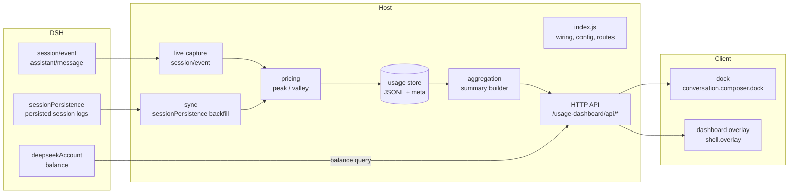

# dsh-usage-analytics · Design notes

> Peak/off-peak billing dock and usage dashboard for DeepSeek Harness.
> Version 0.1.0 · targets DSH `0.2.x` with the Web UI (web profile).

---

## 1. Goal and non-goals

The plugin answers two questions at two different scales:

1. **While I am typing** — what has this conversation cost so far, what is this turn
   costing, am I in a peak or valley window, and how much is left in the account?
2. **After the fact** — where did the tokens and money go over the last week, month or
   quarter? Which models, which days, which hours, and how much was spent at full price
   versus half price?

It does this with two halves:

- a **host half** that captures per-step token usage, prices it, appends it to a durable
  history file and serves it over a small same-origin HTTP API;
- a **client half** that renders a compact dock under the composer and a full-screen
  dashboard overlay on top of the same data.

Explicit non-goals:

- it is not a billing system: numbers are estimates computed locally, the official
  DeepSeek bill is the source of truth;
- it does not upload chat content: history stays in the profile's `DSH_HOME`;
- it does not edit, delete or replace session logs — it only reads them.

---

## 2. Architecture



The host half is plain Node ESM with **no runtime dependencies**; it uses only Node
built-ins and the services DSH injects into the plugin context (`webServer`,
`sessionPersistence`, `deepseekAccount`). The client half is a single
`window.__ModuleLoader__` module that may only `require('react')`, because the DSH Web UI
loads it directly in the browser without a bundler.

### 2.1 Host modules

```text
index.js          plugin entry: config, live capture, sync scheduling, route registration
lib/pricing.js    peak/valley classification, price table, per-step cost, current period
lib/scan.js       session event -> usage record, dedup key, session metadata
lib/sync.js       sessionPersistence backfill with revision/seq watermarks
lib/store.js      JSONL store: load, append, dedup, trim, meta file
lib/aggregate.js  filters -> summary / live payloads (pure functions)
lib/api.js        HTTP handler: summary, live, balance, health, sync
lib/util.js       DSH_HOME resolution, atomic writes, small pure helpers
```

`index.js` is intentionally thin: it resolves config, wires the modules, registers the
prefix route and the event listener, and schedules the warm-up and periodic sync.

### 2.2 Client slots

| Slot | Purpose | Scope |
| --- | --- | --- |
| `conversation.composer.dock` | one compact row under the composer | session (`sessionId` prop) |
| `shell.overlay` | full-screen dashboard, rendered only while open | shell |

The dock polls `live` every 15 s and `balance` every 60 s. The dashboard fetches `summary`
when it opens, whenever a filter changes, and when refresh is pressed. When the panel is
closed (`open === false`) the overlay returns `null` and its data effects are torn down.

---

## 3. Collection: live capture plus backfill

A usage dashboard is only useful if it knows about history that happened *before* it was
installed, and is cheap enough to stay current afterwards. Those are two different
problems, so the collector has two paths.

### 3.1 Live capture (`session/event`)

The host subscribes to `session/event` and keeps only `assistant/message` events that carry
a `usage` object. Each such event is the authoritative billing record for one step:

- `event.data.usage` supplies `inputTokens`, `cacheReadTokens`, `cacheWriteTokens`,
  `outputTokens`;
- `event.data.message.source` supplies `provider` and `model`;
- `event.data.turn` / `event.data.step` and `event.seq` supply the position;
- `event.time` is the timestamp used for peak/valley pricing.

The record is priced immediately (so a later price-table edit never rewrites history) and
handed to the store, which appends it in batches instead of fsyncing on every step.

Live capture deliberately **does not advance the backfill watermark**. The watermark is
only moved by the backfill path: an event can be committed to the log before the plugin
starts but be delivered live by a race, and advancing the watermark from a live event could
make the backfill skip earlier steps of the same session.

### 3.2 Backfill from persisted logs (`sessionPersistence`)

Startup warm-up (about 2.5 s after mount) enumerates durable sessions through
`sessionPersistence.list()`. For each session:

1. compare `snapshot.revision` with the last revision seen in this process, and the meta
   watermark `seq` with `snapshot.eventCount`;
2. if neither moved, skip the session entirely;
3. otherwise `open(id, 'read')`, `read(watermark + 1)`, fold the returned events into usage
   records through `scan.foldSessionEvents`, append them, and store the new watermark plus
   the session label / origin in the meta file.

Backfill runs under a time budget (`maxMs`) rather than in one unbounded pass, so a large
profile cannot block the host. It runs:

| Trigger | Budget | Note |
| --- | --- | --- |
| Startup warm-up | 60 s | runs once, ~2.5 s after mount |
| Periodic sync | 8 s | every 5 minutes, throttled to at most once per 4 minutes |
| `summary` / `live` request | 4 s (`syncBudgetMs`) | keeps an open dashboard fresh |
| `refresh=1` or `POST /api/sync` | 4 s / 15 s | explicit forced re-scan |

The watermark design has two guards: `revision` catches logs that were rewritten without
growing, and `seq` guarantees a crash in the middle of a backfill does not double-count on
the next run.

### 3.3 Idempotency

The dedup key is `` `${sid}#${seq}` `` (`recordKey`). Live capture and backfill both go
through `store.append`, which checks the key set, so a step is counted once whether it
arrives from an event, a log scan, or both. The key survives restarts because it is derived
from the stored records themselves.

---

## 4. Retention and data format

### 4.1 Files

```text
<storageDir>/usage-analytics.jsonl       one JSON record per line, per step
<storageDir>/usage-analytics.meta.json   per-session backfill watermark + display label
```

`storageDir` defaults to `<DSH_HOME>/storages`; `storagePath` (a file path) and
`storageDir` (a directory) override it. `DSH_HOME` is read from the environment variable,
falling back to `~/.dsh`.

- records are appended in batches (a 400 ms flush timer, plus a flush on unload);
- the meta file is written atomically through a temp file and a rename (800 ms debounce);
- **soft cap: 40,000 records** by default, configurable with `historyLimit` (minimum
  1,000). When the cap is exceeded the oldest records are dropped and the whole file is
  rewritten through a temp file + rename, so a crash cannot leave a half-written history.

### 4.2 Record fields

Names are compressed because the file is written for every step of every session.

| Field | Type | Meaning |
| --- | --- | --- |
| `sid` | string | DSH session id |
| `seq` | number | Session event sequence number — half of the dedup key |
| `turn` | number | Turn index inside the session |
| `step` | number | Step index inside the turn |
| `t` | number | Step timestamp, epoch milliseconds (Beijing time used for pricing) |
| `pr` | string | Provider id |
| `m` | string | Model id |
| `i` | number | Cache-miss input tokens |
| `o` | number | Output tokens |
| `cr` | number | Cache-hit input tokens (cache read) |
| `cw` | number | Cache-write input tokens |
| `cost` | number | Estimated cost in CNY, computed at capture time |
| `pk` | number | `1` = peak (full price), `0` = valley |

The API renames these to the long names used by the client (`sessionId`, `time`, `input`,
`cacheRead`, `cacheWrite`, `output`, `peak`) during aggregation, so the storage format and
the wire format can evolve independently.

### 4.3 Meta file

```json
{
  "version": 1,
  "sessions": {
    "session-...": {
      "label": "default",
      "origin": "root",
      "createdAt": 1793414400000,
      "createdAtText": "2026-11-12T00:00:00.000Z",
      "seq": 42,
      "eventCount": 43,
      "lastAt": 1793414400000
    }
  }
}
```

`label` is the workspace directory name (falling back to the first 8 characters of the
session id). Losing the meta file only costs a full re-scan: records are still deduped by
`sid#seq`, so nothing is double counted. Deleting `usage-analytics.jsonl` **and** the meta
file is what a rebuild from the logs requires — keeping the meta file keeps the watermarks,
and the backfill will then correctly conclude there is nothing new to read.

### 4.4 Aggregation on read

The store is the source of truth; nothing derived is persisted. `lib/aggregate.js` folds
filtered records into the response:

| Output | Rule |
| --- | --- |
| `overview` | Sums over the filtered slice: cost, peak / valley cost and steps, tokens by kind, turns, steps, sessions, per-step averages, cache hit rate (`cacheRead / (input + cacheRead)`). Latency fields (`firstTokenMs`, `llmMs`, `toolMs`, `outputTps`) are `null` in v0.1 — the data is not recorded yet |
| `savedValley` | The amount spent in valley hours (the same number as `valleyCost`), not a hypothetical peak-price comparison |
| `days` | One row per Beijing-time day, ascending, last 120 entries at most |
| `models` | Grouped by model, ordered by cost, with `share = cost / overview.cost` |
| `tokenMix` / `modelTokenMix` | Token sums globally and per model |
| `hourly` | 24 Beijing-time buckets, populated only when `day` is set |
| `sessions` | Top 50 sessions by cost, with label, origin, cost, tokens, steps, last activity |
| `groups` / `recent` | The latest 20 turns, grouped with steps in ascending order; `recent` is the same data flattened, capped at 200 steps |

`range` is applied first (`today` / `7d` / `30d` / `90d` / `all`), then `session` (all, or
the single `sid`), then `model`, then `day` (which replaces the range with that single
Beijing-time day and turns on `hourly`).

---

## 5. Pricing

### 5.1 Peak and valley windows

DeepSeek charges different rates in different time windows. The plugin follows the
Beijing-time (UTC+8, no DST) schedule:

| Period | Window | Rate |
| --- | --- | --- |
| Peak | Monday–Friday `09:00–12:00` and `14:00–18:00`, excluding Chinese public holidays | 100% |
| Valley | all remaining time, plus all day Saturday / Sunday / public holidays | `valleyFactor` (0.5 by default) |

Each step is classified by its own timestamp (`t`), not by when the dashboard is opened, so
history keeps the price it was actually billed at. Windows are configurable through
`peakWindows` (minutes from midnight) and `peakDays` (weekday numbers); public holidays go in
`offPeakDates` (`['YYYY-MM-DD']`, Beijing time) because a plugin cannot infer the calendar.

### 5.2 Formula

Prices are CNY per 1 million tokens, per model (peak rates; valley applies `valleyFactor`):

```text
stepCost = ( missInput × price.input
           + cacheRead × price.cacheRead
           + cacheWrite × price.cacheWrite
           + output    × price.output ) / 1_000_000
         × (peak ? 1 : valleyFactor)
```

The default table in `lib/pricing.js` mirrors the official
[DeepSeek pricing page](https://api-docs.deepseek.com/quick_start/pricing) (`PRICE_TABLE_VERSION =
2026-11-13.official`):

| Model key | input (miss) | cacheRead (hit) | cacheWrite | output |
| --- | --- | --- | --- | --- |
| `deepseek-flash`, `deepseek-v4-flash*` | 2 | 0.04 | 0 | 8 |
| `deepseek-v4-pro` | 9 | 0.30 | 0 | 27 |
| `deepseek-chat` (legacy) | 2 | 0.04 | 0 | 8 |
| `deepseek-reasoner` (legacy) | 9 | 0.30 | 0 | 27 |
| `default` | 2 | 0.04 | 0 | 8 |

Cache hits are ~99 % of the token count on a long conversation, so `cacheRead` is the
cost-dominating column; treating it like the miss price overstates the bill by roughly an order
of magnitude. DeepSeek bills cache writes inside the miss price, hence `cacheWrite = 0`.

Model matching is deliberately forgiving: exact id first, then the longest prefix match
(so `deepseek-v4-pro-2026...` lands on `deepseek-v4-pro`), then a heuristic on `reasoner` /
`pro` versus `flash` / `chat`, then `default`. This keeps derived or dated model ids priced
instead of silently costing zero.

**Re-pricing on upgrade.** Each stored record carries `pv` (the `PRICE_TABLE_VERSION` it was
priced with). `store.load({ reprice })` recomputes `cost` / `pk` for records whose `pv` is
stale and rewrites the JSONL once; token counts are untouched. This is how the 0.2.0 price fix
corrected every historical record without re-reading session logs.

**Per-request fees (search / fetch).** Search and Fetch are billed per successful request at
CNY 5 / 1,000 (¥0.005 each), with no peak/valley split. `foldSessionEvents` also turns
`tool/call` events named `web_search` / `web_fetch` into fee records
`{ kind: 'fee', f: 'search' | 'fetch', n, cost, pk: 0 }` (query units for search, URL units for
fetch). Aggregation adds them to `overview.cost`, `overview.feeCost`, the day / hourly / session
cost, and exposes `searchRequests` / `fetchRequests`; they never enter token counts, step
counts, the model distribution or the recent-records list. The client shows them as a separate
"tool fees" line on the peak/valley card. Unit prices are configurable with
`searchPerRequest` / `fetchPerRequest`, and fee records are ignored by the model filter because
they do not belong to a model.

> The result is an **estimate**. DSH may not record every cache write, the provider may
> round differently, public holidays need to be configured, and prices change over time. The
> plugin never claims to reproduce the official bill.

### 5.3 Configuration

The plugin row in the profile's `cordis.patch.yml` accepts:

```yaml
config:
  prices:
    deepseek-flash: { input: 2, cacheRead: 0.04, cacheWrite: 0, output: 8 }
  peakHours: ['09:00-12:00', '14:00-18:00']
  offPeakDates: ['2026-10-01', '2026-10-02']
  storagePath: '/path/to/usage-analytics.jsonl'
  debug: false
```

Advanced keys: `peakWindows` (`[[startMinute, endMinute]]`, wins over `peakHours` when
valid), `peakDays` (`[1..7]`), `valleyFactor` (`0.5`), `storageDir` (wins over
`storagePath`), `historyLimit` (`40000`, minimum `1000`), and `syncBudgetMs` (default
`4000`) which caps request-triggered backfill time.

`config` is replaced wholesale when a patch overrides the row. Inside the host, `prices`
entries replace whole model rows (missing fields become `0`); `peakHours` entries must be
`HH:MM-HH:MM` strings, `peakWindows` entries must be `[start, end]` minute pairs within
`0–1440` with `start < end`, otherwise they are ignored and the defaults apply. A
`storagePath` ending in `.jsonl` is treated as a file path (its directory is the store
directory); anything else, and `storageDir`, is treated as a directory.

---

## 6. HTTP API

All routes are same-origin, relative paths under the `/usage-dashboard` prefix, served with
`cache-control: no-store`. The dashboard itself only needs three GET endpoints; the other
two are for diagnostics and manual resync.

| Method | Path | Query | Returns |
| --- | --- | --- | --- |
| GET | `/usage-dashboard/api/summary` | `range`, `session`, `sid`, `model`, `day`, `refresh` | Overview, days, models, token mix, hourly, sessions, recent, groups, sync and error info |
| GET | `/usage-dashboard/api/live` | `sid` | Current price period and countdown, session totals, current-turn totals |
| GET | `/usage-dashboard/api/balance` | — | Account balance (currency, total, wallets, availability, fetch time) or a failure reason |
| GET | `/usage-dashboard/api/health` | — | Store stats (records, sessions, cap, directory), last sync, store errors |
| POST or GET | `/usage-dashboard/api/sync` | — | Forced backfill result: `added`, `scanned`, `skipped`, `total`, `errors`, `tookMs` |

Behaviour notes:

- `range` defaults to `7d`; `session=current` filters by `sid`; `model` defaults to `all`;
- `day=YYYY-MM-DD` replaces the range with that Beijing-time day and fills `hourly`;
- `refresh=1` forces a backfill before aggregating;
- every `summary` / `live` request also triggers a budgeted backfill (throttled), so a long
  open dashboard keeps converging on the real history;
- balance is cached for 60 s in the host process; failures come back as `{ ok: false }` with
  a reason (`signed-out`, `query-failed`, `account-service-unavailable`) and the client
  renders `—` without an error.

The response shapes are fixed by the client contract; the client treats missing numeric
fields as zero.

---

## 7. Client

### 7.1 Registration

```js
ctx.slots.register({ name: 'conversation.composer.dock', id: 'usage-dashboard', order: 2 }, Dock)
ctx.slots.register({ name: 'shell.overlay', id: 'usage-dashboard', order: 60 }, Overlay)
```

The dock receives the current `sessionId` as a prop (falling back to global stats when it is
undefined). The overlay is always registered but renders `null` until opened, so opening the
dashboard never mounts a second slot.

### 7.2 Interaction

- the dock row is one click target that opens the overlay; the chevron on the right is the
  visual affordance, not a separate control;
- overlay closes on `×`, `Esc`, or a backdrop click; clicks inside the panel do not close it;
- filters are applied as soon as they change, with every request tracked by an id and only
  the latest response applied — a slow earlier request cannot overwrite a newer one;
- `AbortController` cancels in-flight requests when filters change or the panel closes;
- all intervals, document listeners and the injected `<style>` element are removed on
  unmount.

### 7.3 Presentation

- colors come from DSH theme tokens (`--dsw-alias-*`, `--dsw-static-*`), so the dock and
  dashboard follow light and dark themes without their own palette;
- charts are hand-written SVG — a line/area chart, 24-hour bars, a donut and horizontal
  bars — with no charting dependency;
- numbers are formatted compactly (`k`, `M`, `B`; costs to 2 decimals, or 4 when below
  `0.01`);
- all visible strings go through `ctx.locale` with zh / en translations.

---

## 8. Known limitations

- **Backfill reads session logs.** The first scan decodes existing history under a time
  budget; a large profile converges over a few sync rounds rather than in one pass.
- **Balance availability.** Balance requires a signed-in DeepSeek platform account. Without
  one, both dock and dashboard show `—`; the plugin does not prompt for credentials.
- **Estimate, not bill.** See section 5.
- **Retention.** The default 40,000-record soft cap (`historyLimit`) bounds how far `All`
  can see back and trims the oldest steps.
- **Overlapping steps.** Usage is counted per `assistant/message` event, so a step that
  produces several assistant messages is priced per message, not per turn.
- **Scope.** Only usage recorded by this DSH profile is counted; other clients sharing the
  account are invisible.
- **DSH coupling.** The collector depends on `session/event` payloads and the
  `sessionPersistence` snapshot/read contract; a DSH upgrade that changes them needs a
  matching plugin update.
- **Rebuilding history.** Deleting only the JSONL file does not re-backfill: the meta file
  still holds the watermarks. Delete both files to rebuild from session logs.

---

## 9. Directory layout

```text
dsh-usage-analytics/
  package.json          bundle manifest, exports, engines
  cordis.patch.yml      inserts the plugin row
  index.js              host entry: config, capture, sync scheduling, routes
  lib/
    api.js              HTTP handler
    aggregate.js        filters -> summary / live payloads
    pricing.js          peak/valley windows, price table, cost, current period
    scan.js             event -> record, dedup key, session metadata
    store.js            JSONL store and meta file
    sync.js             sessionPersistence backfill
    util.js             DSH_HOME, atomic writes, helpers
  client.js             dock + dashboard (window.__ModuleLoader__)
  locale/               plugin-manager metadata (zh / en)
  icon.svg              plugin icon
  test/                 unit tests (node:test)
  scripts/test.mjs      test entry (imports the suites in one process)
  scripts/check.mjs     static checks
  docs/DESIGN.md        this document
  docs/screenshots/     promo images used by the README
```
